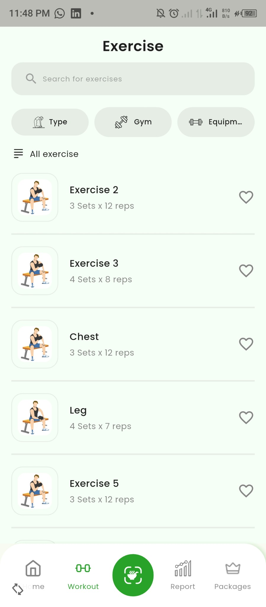
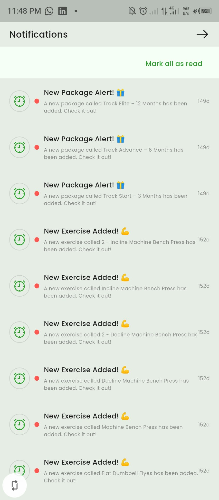
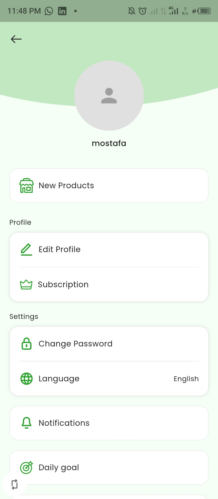
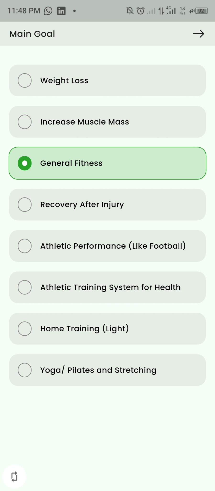
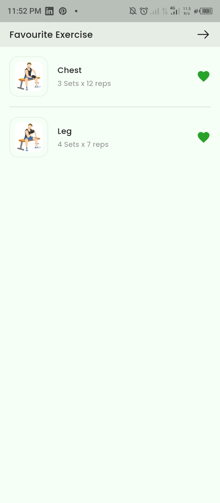
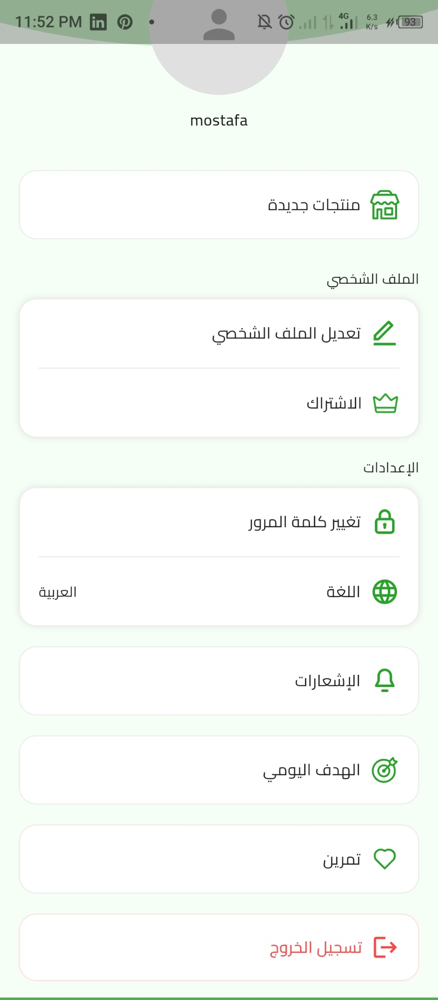
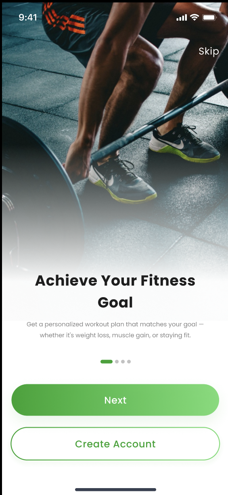
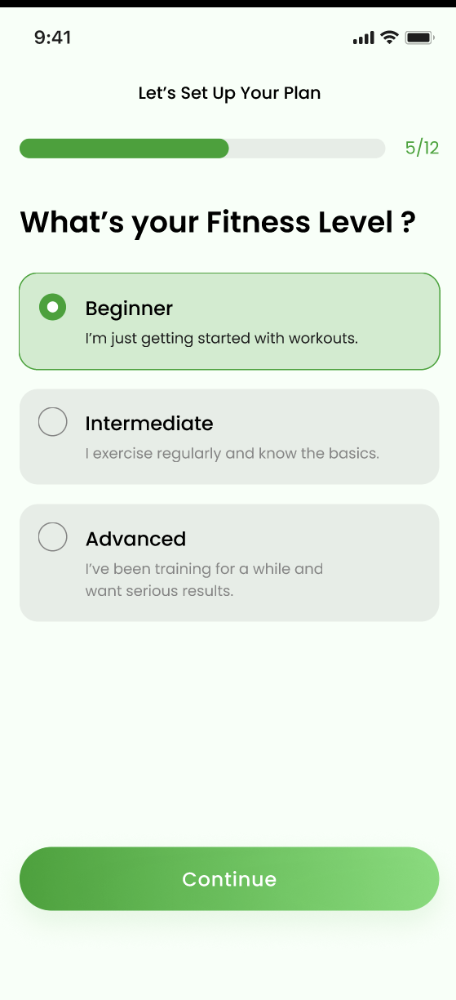
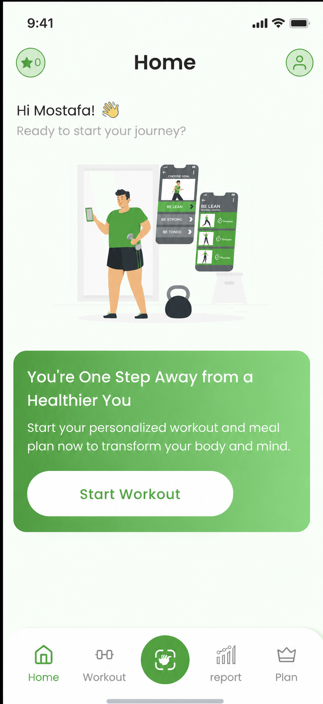
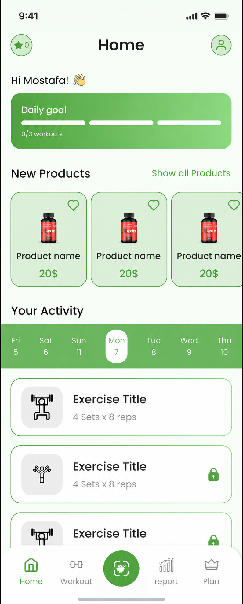

# Track Fit

### A Flutter fitness and coaching companion

Track Fit connects clients with their training program: onboarding, daily workouts, exercise guidance, progress reports, subscription plans, and an in-app supplement store. Client profile and activity data are connected to a separate backend and dashboard used by the coaching team.

**Mobile development:** Mostafa Elsayed · **Stack:** Flutter, Dart, BLoC/Cubit, REST APIs, Firebase

[Explore the code](https://github.com/moelsayed1/the_track_fit) · [GitHub profile](https://github.com/moelsayed1) · [LinkedIn](https://www.linkedin.com/in/moelsayed1)

## My contribution

I developed the Flutter mobile application end to end, implementing its screens, navigation, state management, business logic, and backend integrations. My scope was the mobile application; the backend and coaching dashboard are separate components.

Highlights include sequential exercise unlocking, questionnaire submission, workout filtering, shopping and checkout flows, Arabic/English support, and push notification integration.

## Application screenshots

These images were captured from the running Android application. Content reflects the account and backend data available at capture time.

<table>
<tr><th>Workout library</th><th>Notifications</th><th>Profile</th></tr>
<tr>
<td></td>
<td></td>
<td></td>
</tr>
<tr><th>Fitness goals</th><th>Favorite exercises</th><th>Arabic interface</th></tr>
<tr>
<td></td>
<td></td>
<td></td>
</tr>
</table>

## Features

- **Account and onboarding:** sign-up and a multi-step questionnaire covering fitness level, goals, personal measurements, training environment, and injury history.
- **Daily workout experience:** current-day selection, scheduled exercises, descriptions and GIF demonstrations, and completion-based unlocking of subsequent exercises.
- **Exercise discovery:** search, favorites, and filters for exercise type, equipment, and training location.
- **Store and subscriptions:** supplement browsing, cart and checkout screens, subscription packages, and backend-supported payment options.
- **Activity reports:** interfaces for daily, weekly, and monthly activity summaries.
- **Profile and localization:** account settings, goals, notifications, and Arabic/English interfaces.
- **Notifications:** Firebase Cloud Messaging, foreground local notifications, notification-tap handling, and device-token synchronization with the backend.

### Camera and AI status

The exercise camera interface and feedback UI were prepared for motion analysis. **AI motion tracking and automatic form correction have not been integrated.** These are planned capabilities, not working AI features in this showcase.

## UI design previews

The following are supplied design previews, shown separately from application captures. They illustrate the onboarding and home-screen layouts with sample content. The welcome and home previews were image-edited to change the sample greeting from Nahla to Mostafa; they are not unmodified runtime screenshots.

<table>
<tr><th>Onboarding</th><th>Fitness level</th></tr>
<tr>
<td></td>
<td></td>
</tr>
<tr><th>Welcome</th><th>Daily home</th></tr>
<tr>
<td></td>
<td></td>
</tr>
</table>

## Technology

| Area | Technologies |
| --- | --- |
| Mobile | Flutter, Dart |
| State management | flutter_bloc, Cubit, Equatable |
| Networking | Dio, REST APIs |
| Authentication and notifications | Firebase Auth, Google Sign-In, Firebase Messaging, flutter_local_notifications |
| Navigation and UI | GoRouter, ScreenUtil, SVG, Lottie, Shimmer |
| Reports and preferences | fl_chart, shared_preferences |
| Localization | Flutter localizations, language BLoC and services |

## Code organization

The application is organized by feature, with shared services and reusable UI in `lib/core`. Features use data, repository, model, and presentation layers where applicable; structure varies between modules.

| Location | Responsibility |
| --- | --- |
| `lib/main.dart` | Application startup and service initialization |
| `lib/core/services/` | API, storage, notifications, permissions, and language services |
| `lib/features/auth/` | Authentication |
| `lib/features/questions/` | Onboarding questionnaire |
| `lib/features/workout/` | Exercise state and workout flows |
| `lib/features/store/` and `lib/features/cart/` | Products, cart, and checkout |
| `lib/features/report/` | Activity reporting |
| `lib/features/profile/` | Profile and settings |
| `lib/features/plan/` and `lib/features/plans/` | Plan-related modules |

## Local setup

This application depends on external backend services and Firebase configuration. Cloning the repository alone does not provide a working demo account or production service access.

1. Install a Flutter SDK whose bundled Dart version satisfies the repository's `^3.8.0` constraint. Set up Android tooling; iOS builds require macOS and Xcode.
2. Clone the repository and install dependencies:

```bash
git clone https://github.com/moelsayed1/the_track_fit.git
cd the_track_fit
flutter pub get
```

3. Configure an authorized development backend. Review `lib/core/constants/app_constants.dart` (`AppConstants.baseUrl`) and the API contract in `lib/core/services/api_service.dart`. Use a development account and populated test data.
4. Configure your own Firebase project for the intended Android/iOS application identifiers. Generate `lib/firebase_options.dart` using FlutterFire configuration and supply the platform configuration files as required. Enable the authentication providers used by the app, configure Google Sign-In, and complete platform push notification setup.
5. Run on a configured device or emulator:

```bash
flutter run -t lib/main.dart
```

Backend availability and account setup affect products, exercises, reports, and subscription data. Some supplied captures were taken while backend content was unavailable; loading-error and empty-content screens have been omitted from the main gallery. Setup instructions are based on source inspection, not a fresh end-to-end build verification.

## Developer

**Mostafa Elsayed** — Flutter Mobile Application Developer

[GitHub](https://github.com/moelsayed1) · [LinkedIn](https://www.linkedin.com/in/moelsayed1)
